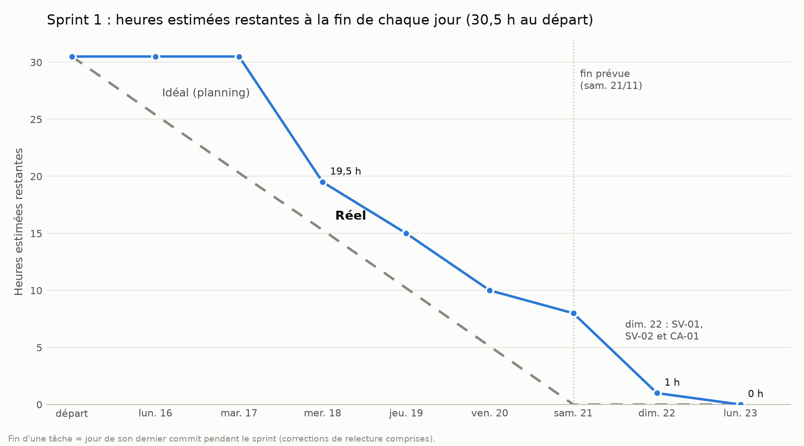

# Sprint 1 — revue, burndown et rétrospective (GP-04)

> Rédigé par la session de pilotage le 23/11/2026, relu par Saliou (GP-04 terminé le 24/11). Heures : créneaux prévus, faute de relevé quotidien (section 3).

## 1. Le sprint en bref

| | Cahier des charges | Planning v2 (19/11) | Réel |
|---|---|---|---|
| Dates | ven. 13/11 → jeu. 19/11 | lun. 16/11 → sam. 21/11 | lun. 16/11 → lun. 23/11 (clôture par cette revue) |
| Objectif | « Nettoyer, comprendre, décrire » : données propres et documentées, survie décrite et modélisée par Cox, stratégie causale arrêtée | idem | **atteint** |
| Tâches | 15 tâches, 30,5 h estimées | idem | 15 terminées sur 15 (GP-04 avec ce document) |
| Jalons | M1 données propres le 17/11 ; M2 point d'étape le 19/11 | M1 le 19/11 ; M2 le 23/11 (date choisie par l'enseignant) | M1 le 19/11 ; M2 le 23/11 |

## 2. Revue : ce qui a été livré

- **Données propres (DA-01 à DA-06)** : audit des 5 fichiers bruts (79 codes d'anomalie, plus 10 contrôles entre tables) ; 35 règles de nettoyage appliquées ; 145 567 → 144 213 lignes, les lignes écartées gardées dans 5 fichiers de rejets ; messages pseudonymisés. Le journal de nettoyage (livrable L2) est produit par le code, chiffres compris. *En clair : chaque correction est justifiée et rejouable par `python run_all.py`.*
- **Base de survie (DA-07)** : 5 000 étudiants, 1 440 décrochages (28,8 %) et 3 560 censurés (71,2 %), avec les variantes à 3 et 5 semaines d'inactivité et la table semaine par semaine. *Aucun censuré n'est perdu : un étudiant transféré compte tant qu'on le suit.*
- **Analyse exploratoire (DA-08)** : les cohortes 2024 et 2025 se ressemblent (écart maximal de 1,9 point sur les profils), ce qui rend crédible la validation « apprendre sur 2024, tester sur 2025 » ; 68 % des tutorats commencent au plus tard en semaine 8.
- **Kaplan-Meier (SV-01)** : 70,9 % des étudiants n'ont pas décroché après 30 semaines (environ 29 % décrochent) ; semaines critiques 4 à 7, puis 15 et 16 ; les courbes diffèrent nettement selon la bourse, la filière, la mention et l'emploi. *Le suivi doit être renforcé en début d'année et à la mi-année.*
- **Modèle de Cox (SV-02)** : 5 000 étudiants, stratifié par cohorte, C-index 0,642 ; associations les plus marquées : emploi en parallèle (HR 1,77) et bourse (HR 0,77) ; hypothèse des risques proportionnels respectée après stratification ; résultats stables avec les seuils de 3 et 5 semaines et sur les dossiers complets. *Ce sont des associations, pas des effets.*
- **Stratégie causale (CA-01)** : DAG, analyse du moment d'entrée en tutorat, photo de la semaine 8 contre le biais du temps immortel (D-53, D-54) : 4 316 étudiants encore inscrits, dont 773 tutorés.
- **Qualité** : 131 fonctions de test à la fin du sprint (commit `b01d611`), relectures indépendantes RV01 (nettoyage, base de survie) et RV02 (spécification causale) suivies de corrections.

## 3. Tâches : prévu et réel

Fin réelle = jour du dernier commit de la tâche pendant le sprint, corrections de relecture comprises (les retouches du 22/11 liées à d'autres tâches ne comptent pas).

Temps réel : non relevé par tâche pendant le sprint 1 (action de la rétrospective). Créneaux prévus du 18 au 23/11 : 6 + 6 + 6 + 5 + 4 + 8 = 35 h, pour 30,5 h estimées ; ces créneaux ne mesurent pas le temps réellement passé (aucun commit le 21/11 après 0 h 12, journée du 22/11 bien plus chargée que ses 4 h prévues). **Correction du 28/11** : heures reconstituées avec Saliou, 6 + 6 + 6 + 0 + 10 + 8 = 36 h du 18 au 23/11 (21/11 sans travail, d'après D-45 ; 22/11 journée complète, environ 10 h), dont une partie est allée aux tâches du sprint 2 tirées en avance. Le temps réel de chaque tâche ci-dessous est reconstitué : heures du jour partagées entre les tâches du jour au prorata de leurs commits (méthode et limites dans `temps_par_tache_brouillon.md`).

| ID | Tâche | Estimation (h) | Prévu (planning v2) | Fin réelle | Écart | Temps réel reconstitué (h) |
|---|---|---:|---|---|---|---:|
| GP-01 | Dépôt, structure, environnement | 1,5 | mer. 18/11 | mer. 18/11 | 0 | 1,3 |
| GP-02 | Kanban et backlog | 1 | mer. 18/11 | mer. 18/11 | 0 | 0,6 |
| GP-03 | Planification du sprint 1, risques, journal | 1 | mer. 18/11 | jeu. 19/11 | +1 j | 2,7 |
| DA-01 | Audit des 5 fichiers | 3 | mer. 18/11 | mer. 18/11 | 0 | 0,5 |
| DA-02 | Nettoyage `etudiants` | 3 | mer. 18/11 | mer. 18/11 | 0 | 1,3 |
| DA-03 | Nettoyage `inscriptions` | 2,5 | mer. 18/11 | mer. 18/11 | 0 | 1,7 |
| DA-04 | Nettoyage `activite_hebdo` et `tutorat` | 2,5 | jeu. 19/11 | jeu. 19/11 | 0 | 1,6 |
| DA-05 | Nettoyage et pseudonymisation `messages` | 1 | jeu. 19/11 | jeu. 19/11 | 0 | 0,6 |
| DA-06 | Journal de nettoyage et tests | 2 | jeu. 19/11 | ven. 20/11 | +1 j (RV01) | 1,6 |
| DA-07 | T, E, base de survie | 3 | jeu. 19/11 | ven. 20/11 | +1 j (RV01) | 4,1 |
| DA-08 | Analyse exploratoire | 2 | ven. 20/11 | sam. 21/11 (0 h 12) | +1 j | 2,0 |
| SV-01 | Kaplan-Meier, log-rank, semaines critiques | 2 | ven. 20/11 | dim. 22/11 | +2 j | 1,2 |
| CA-01 | DAG, entrée en tutorat, photo de la semaine 8 | 2 | ven. 20/11 | dim. 22/11 | +2 j | 1,0 |
| SV-02 | Modèle de Cox | 3 | sam. 21/11 | dim. 22/11 | +1 j | 0,7 |
| GP-04 | Revue, rétrospective, burndown, point d'étape | 1 | sam. 21/11 | lun. 23/11 | +2 j | 0,9 |
| **Total** | | **30,5** | | | | **21,8** |

## 4. Burndown du sprint 1

Données : `burndown_sprint1.csv` (heures estimées restantes à la fin de chaque jour ; ligne idéale du 16/11 au 21/11).

| Jour | Idéal (h) | Réel (h) | Terminées ce jour-là |
|---|---:|---:|---|
| départ | 30,5 | 30,5 | |
| lun. 16/11 | 25,4 | 30,5 | |
| mar. 17/11 | 20,3 | 30,5 | |
| mer. 18/11 | 15,3 | 19,5 | GP-01, GP-02, DA-01, DA-02, DA-03 |
| jeu. 19/11 | 10,2 | 15,0 | GP-03, DA-04, DA-05 |
| ven. 20/11 | 5,1 | 10,0 | DA-06, DA-07 |
| sam. 21/11 | 0 | 8,0 | DA-08 |
| dim. 22/11 | 0 | 1,0 | SV-01, SV-02, CA-01 |
| lun. 23/11 | 0 | 0 | GP-04 |

**Lecture des écarts :**
1. **Départ à plat (16 et 17/11)** : démarrage à J2 et peu de temps le 17/11 ; le Kanban et la planification formelle du sprint ne datent que du 18/11. Au soir du 17/11, il restait 30,5 h au lieu de 20,3.
2. **Mercredi 18/11, la plus forte baisse (11 h)** : audit et nettoyage de deux tables dans la même journée, grâce à des consignes testées d'avance par un prototype (pas d'aller-retour à l'exécution).
3. **Jeudi 19 et vendredi 20/11** : DA-06 et DA-07 ont été codées le 19/11, mais la relecture RV01 du soir même a trouvé des points à corriger (décisions D-42 à D-44, consigne C07), corrigés le 20/11 : un jour de décalage, en échange d'une base de survie vérifiée avant toute analyse.
4. **Samedi 21/11** : seule DA-08, terminée à 0 h 12 ; aucun autre commit ce jour-là (*cause à préciser par Saliou*).
5. **Dimanche 22/11** : SV-01, SV-02 et CA-01 (7 h d'estimation) le même jour, ainsi que des tâches du sprint 2 (CA-02, CA-03, SV-03, SV-04) : le sprint 2 a commencé avant la revue du sprint 1.
6. **Lundi 23/11** : revue faite le jour du point d'étape avec l'enseignant ; le sprint 1 est clos 2 jours après la fin prévue au planning v2 et 4 jours après celle du cahier. Le retard de calendrier est déjà rattrapé : l'effet causal (jalon M3, prévu le 24/11) a été obtenu dans la nuit du 22 au 23/11.

## 5. Point d'étape avec l'enseignant (jalon M2, lundi 23/11)

- **Présenté** : nettoyage et base de survie, Kaplan-Meier et Cox, DAG et photo de la semaine 8, premiers résultats de l'effet du tutorat, à l'appui d'une fiche de présentation et d'un rapport d'avancement préparés pour l'enseignant.
- **Questions posées et réponses** :
  1. Approche causale et mesure de l'effet à privilégier : **laissées à notre choix** ; ce choix technique ne relève pas du client.
  2. LLM local ou par API : **par API, comme dans le projet précédent** (Gemini).
  3. Date de la soutenance : **lundi 30/11** (15 min de présentation, 10 min de questions).
- **Décisions qui en découlent** :
  - spécification causale conservée telle qu'elle a été figée avant le résultat (D-53 à D-62) ;
  - fiches d'alerte par l'API Gemini (D-65, D-66) ;
  - planning v3 (GP-05) : rendu toujours le vendredi 27/11 à 18 h, puis préparation de la soutenance du 30/11.
- **Autres remarques de l'enseignant** : *à compléter par Saliou.*

## 6. Rétrospective (gabarit de l'annexe C)

| À garder | À arrêter | À commencer | Actions (échéance) |
|---|---|---|---|
| Une consigne écrite et testée par un prototype avant chaque exécution : les chiffres de contrôle sont retrouvés à l'exécution. | Laisser le Kanban plusieurs jours sans mise à jour (rattrapage le 22/11). | Noter chaque soir les heures réelles, dans le journal de bord et sur la carte Kanban. | Journal de bord du 19 au 23/11 complété, avec les heures (lun. 23/11 au soir). |
| Les décisions écrites et validées avant de coder ; la spécification causale figée avant de voir le résultat (D-59). | Remplir le journal de bord après coup (entrées du 19 au 23/11 manquantes au moment de la revue). | Rédiger le rapport au fil de l'eau : une section dès qu'une tâche est terminée (risque R6). | Kanban à jour (temps réel, date de fin, lien du commit) et capture du 24/11 (mar. 24/11). |
| La relecture par une session séparée aux points de contrôle : RV01 et RV02 ont trouvé de vrais problèmes, corrigés avant la suite. | Caler la revue de sprint sur une date externe (le point enseignant) : la revue aurait pu se tenir le 21/11. | Vérifier les contraintes d'un outil avant de le retenir : versions compatibles (pandas 3 et lifelines, scikit-survival sous Python 3.14) et quotas d'API (Gemini). | Plan du rapport et premières sections (données, nettoyage) : DO-02 (mar. 24/11). |
| Petits commits avec l'identifiant de la tâche, tests automatiques à chaque règle. | | Préparer les captures du Kanban la veille des dates imposées. | Heures réelles du sprint 1 reportées dans le tableau de la section 3 (mer. 25/11). |
